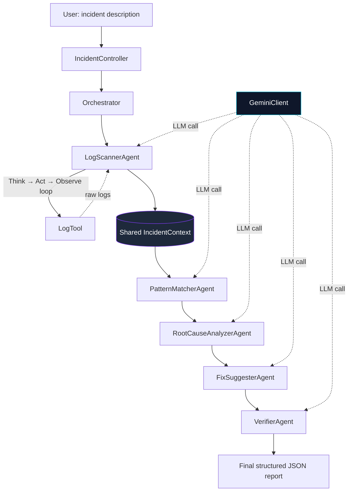
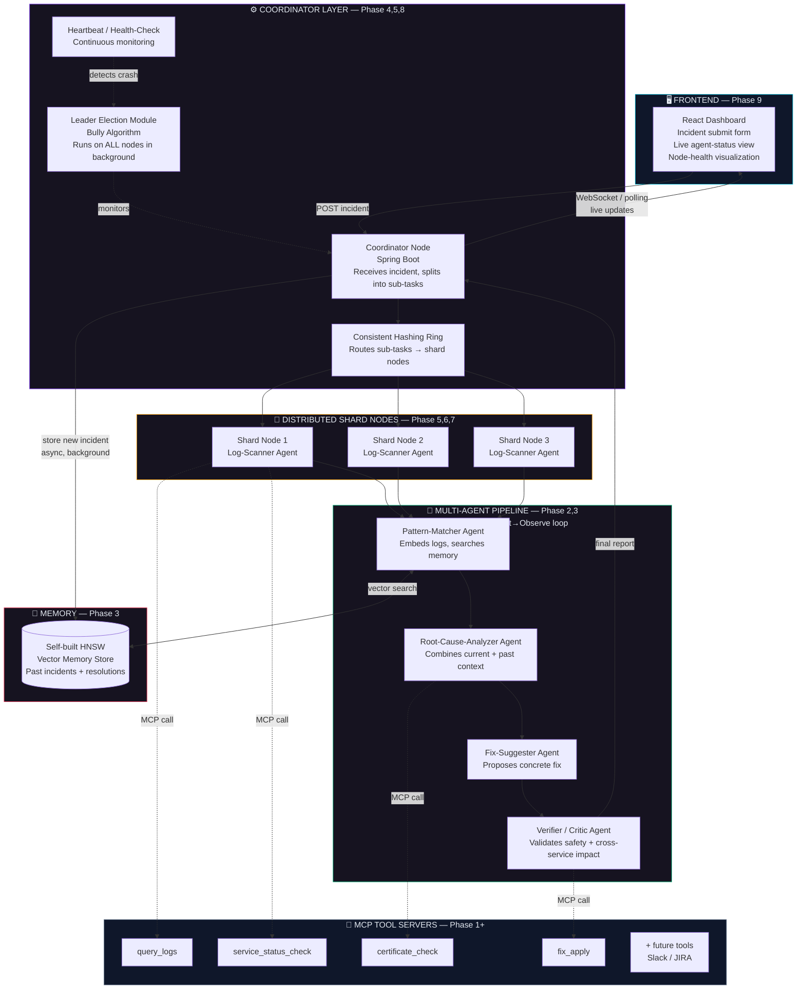

# AgentMesh

**A distributed, fault-tolerant multi-agent AI system that automatically diagnoses production incidents and suggests fixes.**

Built to demonstrate three things together — DSA, distributed-systems design, and real agentic AI engineering (not just an API wrapper) — through one coherent, working system.

---

## Table of Contents

- [The Problem](#the-problem)
- [What AgentMesh Does](#what-agentmesh-does)
- [Architecture](#architecture)
- [Agent Roles](#agent-roles)
- [Why This Design](#why-this-design)
- [Tech Stack](#tech-stack)
- [Project Roadmap / Status](#project-roadmap--status)
- [Running Locally](#running-locally)
- [Example](#example)

---

## The Problem

When a microservice fails in production, engineers manually correlate logs across dozens of services to find the root cause. This is slow, error-prone, and every minute of downtime is direct revenue loss. Worse, the knowledge from past incidents usually lives in one engineer's head — it isn't systematically reused the next time the same class of bug appears.

AgentMesh automates this diagnostic process using a pipeline of specialized AI agents — each responsible for one narrow part of the investigation — working together the way an on-call engineering team would, but automated and (eventually) parallelized across nodes.

## What AgentMesh Does

Given a plain-text incident description, AgentMesh:

1. Fetches relevant logs for the affected service(s)
2. Matches the incident against similar past incidents
3. Diagnoses the most likely root cause
4. Suggests a concrete, actionable fix
5. **Independently verifies** that the fix actually addresses the root cause — and doesn't just mask the symptom or introduce a new risk

The output is a structured report an on-call engineer can act on immediately.

## Architecture

**Current state (Phase 2 — multi-agent pipeline, single process):**



Every agent communicates only through a single shared `IncidentContext` object — no agent has a direct reference to any other agent. This keeps the design loosely coupled: any agent could be swapped, retried, or moved to a different node later without the others knowing.

**Planned end-state (full system, Phase 1-9):**



## Agent Roles

Each agent has a single, narrow responsibility — deliberately, not all agents are built the same way:

| Agent | Responsibility | Uses a tool / loop? |
|---|---|---|
| **LogScannerAgent** | Fetches relevant logs for the affected service(s) | **Yes** — runs its own Think→Act→Observe loop, decides when/what to call `query_logs`, and when it has enough data |
| **PatternMatcherAgent** | Finds a similar past incident for context | No — single LLM call (will be replaced by real HNSW similarity search in Phase 3) |
| **RootCauseAnalyzerAgent** | Diagnoses the most likely root cause from logs + similar incident | No — single LLM call |
| **FixSuggesterAgent** | Suggests one concrete, actionable fix | No — single LLM call |
| **VerifierAgent** (Critic) | Independently checks whether the fix actually solves the root cause, or just masks a symptom / introduces new risk | No — single LLM call, structured JSON output (`verified`, `reason`) |

Only `LogScannerAgent` needs external tool access, so it's the only agent with a reasoning loop. The other four are pure single-shot reasoning agents — giving each agent exactly as much autonomy as its job requires, rather than a generic loop everywhere.

## Why This Design

- **The Verifier is not a rubber stamp.** In testing, it has already caught a fix that would have masked the real problem — a suggestion to increase a database connection-pool size was rejected because the actual root cause was a slow, unindexed query; increasing the pool size would have hidden the symptom while risking overload on the database. This is the real value of a critic/verification step in a multi-agent pipeline, not just an extra API call for show.
- **A shared context object, not agent-to-agent messaging.** Agents read and write to one `IncidentContext`, never to each other directly. This is closer to a pipeline/Chain-of-Responsibility pattern than a chatty multi-agent conversation, and it's what makes the Orchestrator swappable for a real distributed Coordinator later without changing any agent's internals.
- **Tool-use is scoped to where it's genuinely needed.** Not every agent gets a tool-calling loop by default — only the one that actually needs an external action.
- **Simulated incident data, by design.** There's no live production system to pull real incidents from, so AgentMesh currently runs against representative/simulated log data. This is a known, intentional limitation for a portfolio project, not an oversight.

## Tech Stack

- **Backend:** Java, Spring Boot (Maven)
- **AI:** Gemini API (`gemini-3.6-flash`) via direct REST calls — no LangChain or agent framework; the Think→Act→Observe loop and tool-calling protocol are built from scratch
- **Resilience:** Exponential-backoff retry in the LLM client for transient upstream failures (e.g. `503 Service Unavailable`)
- **Planned:** Self-implemented HNSW (vector similarity search), consistent hashing (log/task sharding), Bully algorithm (leader election), Docker Compose (multi-node), React (live dashboard)

## Project Roadmap / Status

| Phase | Milestone | Status |
|---|---|---|
| 0 | Project setup, Gemini API integration, Git repo | ✅ Done |
| 1 | Single agent, single node — tool-calling loop working end-to-end | ✅ Done |
| 2 | Multi-agent pipeline — shared context, five specialized agents, verification step | ✅ Done |
| 3 | Self-implemented HNSW vector memory for real incident-similarity search | ⏳ In progress |
| 4 | Agents made service-ready — each on its own REST endpoint | ⏳ Planned |
| 5 | Consistent hashing — dynamic task/log routing across nodes | ⏳ Planned |
| 6 | Docker Compose — real multi-node containerized system | ⏳ Planned |
| 7 | Health checks + fault-tolerance testing (node crash & retry) | ⏳ Planned |
| 8 | Leader election (Bully algorithm) — fail-safe coordinator | ⏳ Planned |
| 9 | React frontend — live agent status & node health dashboard | ⏳ Planned |
| 10 | Polish — final README, architecture diagrams, demo video | ⏳ Planned |

## Running Locally

**Prerequisites:** Java 21+, Maven, a Gemini API key.

```bash
# 1. Set your API key as an environment variable
export GEMINI_API_KEY=your_key_here      # Windows (PowerShell): $env:GEMINI_API_KEY="your_key_here"

# 2. Run the app
mvn spring-boot:run
```

Send a `POST` request to the running server:

```
POST http://localhost:8080/agent/execute
Content-Type: text/plain

Payment service is throwing HTTP 504 errors since 2:00 PM.
```

## Example

**Request:**
```
Payment service mein HTTP 504 errors spike ho rahe hain 2:00 PM se.
```

**Response (abbreviated):**
```json
{
  "rootCause": "Connection pool exhaustion in payment-service's HikariPool — long-running queries held all 10 connections under load.",
  "suggestedFix": "Increase spring.datasource.hikari.maximum-pool-size from 10 to 30.",
  "verified": false,
  "verificationReason": "Increasing pool size masks the symptom without fixing the slow/long-running queries, and risks overloading the database."
}
```

Notice the pipeline doesn't just hand over a fix — the Verifier agent flags that this particular fix treats a symptom, not the disease, giving the on-call engineer real signal rather than blind automation.

---

*Built by Vansh Saini — 3rd-year CSE, as a portfolio project demonstrating distributed systems and agentic AI engineering.*
